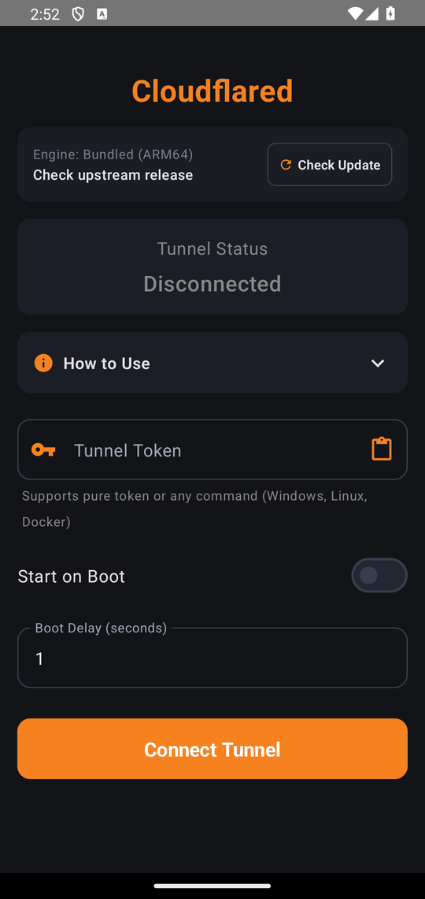

# Cloudflared for Android
## Native Cloudflare Zero Trust Tunnel Client

[-3DDC84?logo=android&logoColor=white)](https://developer.android.com)
[](https://github.com/cloudflare/cloudflared)
[](LICENSE)
[](https://github.com/roufsweb/cloudflared-android/releases/tag/v1.2.0)
[](https://roufsweb.github.io/cloudflared-android/)

A lightweight, high-performance native implementation of Cloudflare Tunnel (`cloudflared`) engineered specifically for Android. Expose local web applications, APIs, Termux environments, and home servers to the public internet using Cloudflare Zero Trust without requiring root permissions, dynamic DNS, or router port-forwarding.

*Interactive step-by-step setup walkthrough and troubleshooting guide:* **[roufsweb.github.io/cloudflared-android](https://roufsweb.github.io/cloudflared-android/)**

---

## Direct APK Download

Ready-to-install application packages are published under [Releases](https://github.com/roufsweb/cloudflared-android/releases):

| Package | Supported Architecture | Minimum Android Version | Direct Download |
|:---|:---:|:---:|:---:|
| **Cloudflared Android APK** | ARM64-v8a | Android 5.0+ (Lollipop through Android 15) | [Download Latest APK](https://github.com/roufsweb/cloudflared-android/releases/download/v1.2.0/cloudflared-non-rooted.apk) |

---

## Application Interface

<p align="center">
  
</p>

---

## Key Capabilities

* **Standard Non-Root Execution:** Runs completely inside the standard unprivileged Android app sandbox. No superuser, Magisk, or custom ROMs required.
* **Universal Token Parser:** Automatically extracts and validates Base64 tokens from any command copied from the Cloudflare dashboard (Windows `.exe`, Linux `sudo`, Docker, or raw token) with one-tap clipboard paste.
* **Integrated Engine Updates:** Checks upstream Cloudflare releases and applies binary updates and kernel patches with a single tap in the app.
* **In-App Usage Instructions:** Built-in collapsible guide detailing token creation, background battery whitelist steps, and public hostname routing.
* **Kernel Stdin DNS Patching:** Overcomes Android's absence of `/etc/resolv.conf` by routing the Go runtime pure-Go resolver via `//proc/self/fd/0` with built-in upstream resolvers (1.1.1.1, 8.8.8.8).
* **Direct Boot Compatibility:** Utilizes `LOCKED_BOOT_COMPLETED` broadcast receivers to resume tunnel connections automatically after a system reboot, even before first user unlock.
* **Foreground Service Persistence:** Operates as an Android high-priority foreground service (`dataSync` type) with partial WakeLock management to withstand aggressive OEM task termination.
* **Firewall & CGNAT Bypass:** Outbound encrypted connections over QUIC (port 7844) or HTTP/2 (port 443) bypass carrier-grade NAT and restrictive ISP firewalls.

---

## Universal Token Input Support

The application features a built-in token parser (`TunnelTokenParser`). When configuring a tunnel in the Cloudflare Zero Trust Dashboard, users can copy the full installation command provided under **any** operating system tab and paste it directly into the application. The parser strips executable names, sudo wrappers, CLI flags, quotes, and whitespace, isolating only the valid token payload:

| Source Format | Example Input Copied from Dashboard | App Parsing Behavior |
|:---|:---|:---|
| **Windows Command** | `cloudflared.exe service install eyJhIjoi...` | Automatically strips `cloudflared.exe service install` and extracts token |
| **Linux Command** | `sudo cloudflared service install eyJhIjoi...` | Automatically strips `sudo cloudflared service install` and extracts token |
| **Docker Command** | `docker run cloudflare/cloudflared:latest tunnel --token eyJhIjoi...` | Automatically isolates `--token` parameter value and strips flags |
| **PowerShell / Paths** | `.\cloudflared.exe service install "eyJhIjoi..."` | Cleans quotation marks, relative execution prefixes, and arguments |
| **Raw Base64 Token** | `eyJhIjoiMzEyNDZl...` | Trims whitespace, line breaks, and extraneous characters |
| **One-Tap Clipboard** | *(Tap the clipboard icon inside the input field)* | Fetches system clipboard and auto-parses contents directly |

### Token Structure & Real-Time Validation
Cloudflare Zero Trust tunnel tokens are Base64-encoded JSON objects containing account metadata:
```json
{
  "a": "<account_id>",
  "t": "<tunnel_id>",
  "s": "<secret>"
}
```
Upon paste or typing, the application instantly verifies the Base64 structure, parses the `a` and `t` keys, and displays a live validation badge with the detected **Tunnel ID** (`Valid Token • Tunnel: <id>...`) so you can be confident your token is valid before starting the connection.

---

## Architecture

Standard Go binaries fail on Android because Android's Bionic C library does not provide `/etc/resolv.conf`, causing DNS lookup failures. This wrapper solves that natively:

```
[Local Application / Termux] (e.g. localhost:8080)
            |
            v
[Cloudflared Native Engine (libcloudflared.so)]
            |
            +--> DNS Redirection: Stdin Pipe -> //proc/self/fd/0 (1.1.1.1, 8.8.8.8)
            |
            v  (Outbound HTTPS / QUIC on Port 7844 / 443)
[Cloudflare Edge Global Anycast Network]
            |
            v
[Public Internet / Custom Domain] (e.g. https://service.yourdomain.com)
```

1. The compiled `cloudflared` binary is packaged as a native shared library (`libcloudflared.so`) within the APK.
2. The Android service spawns the binary and pipes a generated resolver configuration directly into stdin.
3. The patched engine parses nameservers via `//proc/self/fd/0`, establishing secure outbound connections to Cloudflare Edge.

---

## Quick Setup

### Step 1: Obtain a Tunnel Token
1. Open the [Cloudflare Zero Trust Dashboard](https://one.dash.cloudflare.com/).
2. Navigate to **Networks** > **Tunnels** > **Add a tunnel**.
3. Select **Cloudflared** and name your tunnel.
4. Under **Install and run a connector**, copy the command provided under any OS tab (Windows, Linux, or Docker), or copy just the token string:
   ```bash
   cloudflared.exe service install eyJhIjoiMzEyNDZl...
   # or
   sudo cloudflared service install eyJhIjoiMzEyNDZl...
   ```

### Step 2: Connect the Android App
1. Install and launch `cloudflared-android.apk`.
2. Tap the **Paste from Clipboard** icon in the **Tunnel Token** field (or paste manually). The app extracts and validates the token automatically, displaying a green confirmation badge with your Tunnel ID.
3. Tap **Connect Tunnel**.
4. Grant notification permission and allow the battery optimization exemption when prompted.

### Step 3: Route Public Traffic
In the Cloudflare dashboard under the tunnel's **Public Hostnames** tab, assign a domain to your Android service:
* **Public Hostname:** `mydevice.yourdomain.com`
* **Service Type:** `HTTP`
* **URL:** `localhost:8080` (or your target local port)

---

## Common Applications

### Exposing Termux Web Servers
Host lightweight APIs, web servers, or static pages directly from Termux:
```bash
# Start a local web server in Termux
python3 -m http.server 8080

# In Cloudflare Dashboard: Route public hostname to localhost:8080
```

### Low-Power Homelab Node
Convert a spare Android smartphone or tablet into an always-on, low-power server for:
* Home Assistant dashboards and automations
* Node-RED automation workflows
* PocketBase or SQLite micro-backends
* Webhook ingestion (Stripe, GitHub, Discord bots)

---

## Background Reliability

To ensure uninterrupted 24/7 tunnel execution across device manufacturers:

| Vendor | Configuration Path | Setting |
|:---|:---|:---|
| **Google Pixel / AOSP** | Settings > Apps > Cloudflared > App battery usage | **Unrestricted** |
| **Samsung (One UI)** | Settings > Battery > Background usage limits | Add to **Never sleeping apps** |
| **Xiaomi (HyperOS / MIUI)** | App Info > Battery saver | **No restrictions** & enable **Autostart** |
| **OnePlus / Oppo / Realme** | App Info > Battery usage | Enable **Allow background activity** & **Allow auto-launch** |

For comprehensive guides, visit the online documentation at [roufsweb.github.io/cloudflared-android](https://roufsweb.github.io/cloudflared-android/).

---

## Building from Source

### Requirements
* Android Studio (2023.2.1 Iguana or newer)
* Android SDK 34
* JDK 17

### Build Command
```bash
./gradlew assembleRelease
```

The output package will be generated at:
```text
app/build/outputs/apk/release/cloudflared-android.apk
```

---

## Contributors & Acknowledgments

<table>
  <tr>
    <td align="center" width="160px">
      <a href="https://github.com/roufsweb">
        <br />
        <sub><b>Abdur Rouf</b></sub>
      </a>
      <br />
      <sub>Creator & Maintainer</sub>
    </td>
    <td align="center" width="160px">
      <a href="https://github.com/google-antigravity">
        <br />
        <sub><b>Google Antigravity</b></sub>
      </a>
      <br />
      <sub>Architecture & Engineering</sub>
    </td>
  </tr>
</table>

---

## Disclaimer
Cloudflare, Cloudflare Tunnel, and Cloudflare Zero Trust are registered trademarks of Cloudflare, Inc. This project is an independent open-source client and is not affiliated with or endorsed by Cloudflare.
